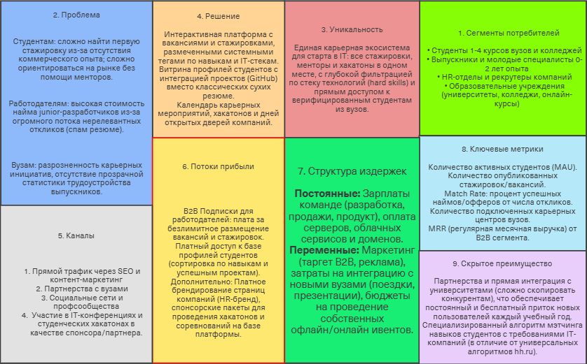

# CareerBridge

## Elevator Pitch
Студенты и молодые специалисты тратят часы на поиск актуальных вакансий, стажировок и карьерных событий, разбросанных по десяткам сайтов и соцсетей. Компании тратят бюджеты на рекламу, но не достигают целевой аудитории — талантливых кандидатов, готовых к развитию в их отрасли. В результате таланты упускают возможности, а компании недополучают квалифицированных сотрудников.

Разработан CareerBridge: интерактивная платформа, которая собирает в публичном доступе всю информацию о вакансиях, стажировках, менторских программах и карьерных мероприятиях (дни открытых дверей, хакатоны, лекции от компаний). Платформа персонализирует рекомендации под профиль пользователя, показывает пропущенные возможности и формирует индивидуальный карьерный путь.

Главное отличие CareerBridge от обычных агрегаторов вакансий — мы создаем экосистему взаимодействия между талантами и компаниями через менторство, события и целевые предложения. Мы выстраиваем партнёрства с образовательными учреждениями и отраслевыми ассоциациями, чтобы обеспечить контент. А если компания хочет проверить навыки кандидата, CareerBridge предоставляет инструменты для технических заданий и кейс-чемпионатов. Пользователь получает персональный карьерный дайджест и видит, где у него пробелы в навыках.

В результате таланты быстрее находят подходящие возможности и осознанно строят свою карьеру, а компании получают доступ к мотивированным кандидатам с подтвержденными навыками.

## Проблема
- Студенты и молодые специалисты тратят 10+ часов в неделю на поиск по разным источникам
- 68% выпускников устраиваются не по специальности в первые 2 года работы
- Компании тратят до 30% бюджета на подбор на ineffective каналы
- Отсутствие персонализированного карьерного руководства для early career талантов

## Уникальная ценность
Единственная платформа, которая объединяет вакансии, стажировки и карьерные события с персонализированными рекомендациями и инструментами для развития навыков, создавая замкнутый цикл "обучение — практика — трудоустройство".

## Business Model (Lean Canvas)

